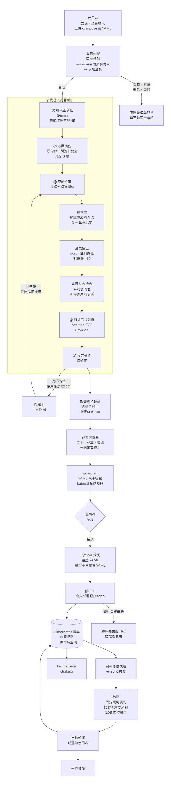

# ZeroTouch：用一句話部署 Kubernetes 服務的平台

長庚大學資工系畢業專題。

> 這份說明介紹的是目前最新的版本。多代理人部署解析、llama.cpp 推理引擎、選軟體信心度這幾項的程式在 [`integrate/multiagent-llamacpp`](https://github.com/neilhuangmobile-art/LLM-enabled-Zero-Touch-Kubernetes-Service-Deployment-Platform/tree/integrate/multiagent-llamacpp) 分支，還沒有合併進 main。

---

## 專題作品概述

ZeroTouch 是一套網頁平台，讓不熟 Kubernetes 的人，只要用一句話說出自己想要什麼服務，就能把服務真的部署到 Kubernetes 叢集上，部署完之後平台還會繼續幫忙顧著。

會想做這個題目，是因為我們自己在學 Kubernetes 的時候吃了不少苦頭。要把一個網站跑起來，得先寫 Deployment、Service 的 YAML，搞懂副本數、記憶體上限、健康檢查要怎麼設，接著用 kubectl 套用，套用失敗還要看得懂錯誤訊息。對新手來說，每一步都可能卡住。市面上已經有不少 AI 工具可以幫忙「產生 YAML」或「解釋錯誤」，但用的人最後還是得自己看懂 YAML、自己判斷要不要套用，難的部分其實沒有少。

所以我們換了一個方向：使用者不需要看懂 YAML，平台替他做決定，但每個決定都要讓他看得到、改得了。

實際用起來大概是這樣。使用者在對話框裡打一句話，可以很具體，像是「幫我開 3 個 nginx 1.27，開 80 port」；也可以只描述情境，像是「我想給社團做一個報名頁，大概五十個人會用，活動辦兩天」。平台會把這句話整理成一張部署規格，用哪個軟體、開幾份、用哪個 port、給多少記憶體和 CPU 都會列出來，每個欄位旁邊還標了是使用者自己講的、還是系統推出來的，以及系統對這個值有多少把握。接著安全、成本、效能三個審查模組各自檢查一遍，再用 kubectl 先試跑驗證一次。使用者看過、按下確認之後，才會真的部署。

部署完平台不會就此不管。背景每 30 秒會掃描一次所有服務，發現容器一直重啟、記憶體不夠被系統停掉、映像檔拉不下來這類問題，就自動判斷原因並嘗試修復，修了什麼也會推播到使用者的手機。

整套系統的模型大多跑在我們自己的顯卡上（Qwen 系列的小模型，用 llama.cpp 執行），只有「判斷使用者想做什麼」和「把句子整理成固定格式」這兩步會用到 Google 的 Gemini，Gemini 連不上的時候也會改用本地模型。服務的 log 和叢集狀態不會送到外部。

---

## 系統功能簡介

### 對話式部署

這是平台最主要的入口。使用者在對話頁打字或用語音說出需求，平台會先判斷他是想部署、想查服務狀態、想擴縮或刪除，還是只是想問 Kubernetes 的問題，再走對應的流程。

部署的話會依序經過下面幾個步驟：

1. **整理需求**：把句子整理成固定格式的中間資料，只寫使用者真的講過的東西，原句找不到根據的內容會被丟掉。
2. **檢查有沒有漏掉**：本地模型拿原句和整理好的資料比對，看有沒有「明明講了卻沒寫進去」的內容，最多來回檢查 3 輪。
3. **補上空的欄位**：使用者沒講的欄位由推理模型補上。選軟體的時候，平台會先從軟體知識庫（目前 76 套常見的開源軟體）找出最相關的 5 套，再讓模型逐一判斷「這是不是使用者要的那一類軟體」，用模型回答「是」的機率當分數。分數夠高就採用，不夠高就把候選列出來問使用者。port、資料存放位置、建議的記憶體則直接查表補上。
4. **確認沒有矛盾**：系統補上的值如果跟原句衝突，會被找出來修正，修不好就問使用者。
5. **處理額外需求**：密碼會轉成 Secret，要保存資料的會轉成 PVC，要定時執行的會轉成 CronJob；平台做不到的需求會標成「不支援」並告訴使用者。
6. **格式檢查**：最後再檢查一次每個值的格式，不合格的修正後重新檢查。

如果過程中有平台不能替使用者決定的事情，會把所有問題整理在同一張卡片上一次問完，每題都先選好推薦的答案，使用者也可以直接按「幫我決定」。回答完之後，平台會從剛才的進度接著跑。

### 部署規格確認與信心度

部署規格的每個欄位旁邊都有一個有顏色的數字。使用者自己講的值顯示 100%；系統推出來的值，顯示的是我們在測試題組上實際量到的正確率，不是模型自己說的機率。我們實測過，模型自己說有 95% 把握的時候，實際上只有 67% 到 81% 是對的，所以沒拿它直接用。數字在 85% 以上顯示綠色、65% 以上黃色，更低的是紅色，提醒使用者特別看一下。

### 部署前的三項審查與試跑驗證

部署之前，安全、成本、效能三個審查模組會各自檢查一次：

- **安全**：有沒有用到特權模式、掛載主機目錄、以系統管理員身分執行這類危險設定。
- **成本**：估算這個服務一個月大概要花多少錢。
- **效能**：資源設定合不合理，叢集剩下的容量夠不夠。

三個模組的結果會合成「通過」、「警告」或「擋下」。警告的話使用者看完仍然可以決定要部署，擋下的話就不能部署，畫面上會說明原因。通過審查後，平台還會用 kubectl 先試跑驗證一次，確認 Kubernetes 本身也接受這份設定。

### 情境部署與省錢估算

使用者只描述情境、沒講技術細節的時候，平台會依照描述推算需要的規格。例如講了大概多少人用、活動辦幾天，平台會估算尖峰時段同時在線的人數，算出需要幾份副本，並且跟「沒考慮情境、照一般做法開一整個月」的費用做比較，告訴使用者大概能省多少。如果服務只需要用幾天，也會提醒使用者用完記得刪掉。

### 匯入既有的設定檔

已經有 docker-compose 檔案或 Kubernetes YAML 的人，可以直接上傳，平台會把它轉成部署規格，一樣經過審查和確認才部署。compose 檔裡有好幾個服務的話，會列出每個服務讓使用者逐一確認。

### 服務管理

「我的服務」頁會列出使用者部署過的每個服務，以及它底下實際在跑的 Pod。點進去可以看詳細狀態、最近的 log 和事件，也可以調整副本數、更新映像檔、回到上一版，或刪除服務。這些會改變服務的操作都要按兩次確認，第一次會先顯示「改了之後會變成什麼樣子」。

這些操作也都可以在對話裡直接講，例如「把 shop-web 調成 3 個」，平台一樣會先跳出確認畫面。

### 定時執行

要每天備份、每小時清一次資料這類需求，平台會部署成定時執行的工作。時間以台灣時間計算，為了避免把叢集塞滿，間隔至少 5 分鐘，每次最多執行 1 小時，也不會讓上一次還沒跑完的時候又開始下一次。

### 自動修復

平台背景每 30 秒掃描一次所有服務。目前能處理的狀況和做法如下：

| 狀況 | 平台的處理 |
|---|---|
| 記憶體不夠，被系統停掉 | 調高記憶體上限 |
| 映像檔拉不下來 | 退回到上一個映像檔不一樣的版本 |
| 健康檢查太早開始，程式還沒啟動完就被判定失敗 | 加長健康檢查的等待時間 |
| 容器一直重啟 | 重新建立 Pod |
| 連不上資料庫、缺設定檔、權限不足這類平台不能亂改的問題 | 不動手，只告訴使用者原因和建議 |

判斷原因的時候，平台會先用固定規則比對 log 和事件，比對不到才交給監控用的小模型。我們發現小模型在證據不足的時候很容易自己編一個聽起來很具體的原因，所以加了一道檢查：log 和事件裡找不到具體錯誤的話，就老實說「證據不足」；模型提到的軟體名稱如果在 log 裡根本找不到，那段說明也會換掉。每次修復都會記在紀錄裡並推播到手機，同一個問題 6 小時內只通知一次。

我們也知道這部分還有不少要補的地方，例如修完之後沒有驗證是不是真的好了、調高記憶體沒有設上限，補強計畫寫在 [docs/healer_plan_20261120.md](docs/healer_plan_20261120.md)，也開成了 GitHub issue #2。

### 分時擴縮與閒置休眠

可以在對話裡說「shop-web 白天 3 個、晚上 1 個」，平台就會照時段自動調整副本數。服務如果很久都沒有人連線，會自動降到 0 份來省資源，之後有人連進來再自動喚醒，喚醒大約需要 30 秒到 1 分鐘。不想被休眠的服務，說一聲「shop-web 不要休眠」就可以排除。

平台也會記錄每個服務每個小時收到的流量，累積滿 7 天之後，可以依照實際的使用情況建議時段。這只是建議，要使用者按下「套用」才會生效。

### 行事曆與預約任務

「明天早上 9 點幫我部署 xxx」這類要求會變成預約任務，顯示在行事曆上。時間到了，平台會先提醒使用者，等使用者確認之後才去執行。這樣設計是因為從預約到執行的這段時間，叢集的狀況可能已經變了。

### 資源總覽與監控

資源總覽頁顯示叢集整體和每個服務的 CPU、記憶體用量。資料來自叢集裡安裝的 Prometheus，也可以另外打開 Grafana 看更細的圖表。Prometheus 查不到資料的時候，畫面上會直接寫「無法取得」，不會用 0 帶過。

### 分析報告

說一句「幫我整理這週的狀況」，平台會整理出一份有圖有文字的報告，內容包括部署了哪些服務、出過什麼問題、自動修復了幾次等等，可以下載成 PDF。另外每週一早上 9 點，平台會自動替每個帳號產生上一週的報告並推播通知，不想收的話在對話裡說一聲就可以關掉。

### 專案、對話紀錄與回收桶

對話紀錄存在伺服器上，換一台電腦登入一樣看得到。相關的對話、服務和檔案可以收進同一個「專案」，專案裡可以寫說明、指示，也可以設定部署預設值，例如這個專案的服務至少要開幾份、給多少記憶體。刪掉的對話和專案會先放進回收桶，7 天後才真的刪除。

### 手機版與推播

用手機打開平台會自動進入手機監控版，可以看服務狀態、資源用量和修復紀錄，但不能部署或修改，避免在小螢幕上誤按。平台可以加到手機主畫面當 App 使用，自動修復、排程擴縮、休眠喚醒這些平台自己做的動作都會推播通知。

### 帳號與多使用者隔離

每個帳號在叢集裡有自己的命名空間，也設了資源配額，所以一個使用者只看得到、也只改得到自己的服務。配額是由 Kubernetes 本身強制執行的，不只是平台畫面上的檢查。可以用一般帳號密碼註冊，也支援 Google 登入。

### 客戶自帶叢集

有自己 Kubernetes 叢集的使用者，可以把叢集接上平台。做法是複製一行安裝指令到自己的電腦執行，裝好之後平台就能替他部署和管理服務。

這裡我們特別注意了安全性：平台不會連進客戶的叢集。所有變更都寫成 Git 紀錄，存在平台替客戶開的私有 repo 裡，客戶叢集裡的 Flux 用唯讀權限每 30 秒去拉一次再套用。叢集的狀態則由客戶叢集裡一個唯讀的回報程式，每 15 秒回傳給平台。也就是說，每一個動作都有 Git 紀錄可以查，也都可以退回。

### 個人化建議

部署規格裡沒填的記憶體和 CPU，平台會參考使用者自己過去的部署習慣來建議。部署次數還不到 3 次的新使用者，則參考我們從 6 萬多份公開 Kubernetes 設定檔統計出來的常見寫法。順序是使用者在句子裡講的最優先，其次是專案的部署預設值，最後才是個人化建議，而且只會填空著的欄位。

### 部署紀錄

每次部署都會把產生的設定檔寫進一個專門存部署紀錄的 Git repo，所以每個版本改了什麼都查得到，需要時也可以換回上一版。部署請求如果因為網路不穩被重送，平台會認出是同一個請求，不會重複部署。

---

## 系統架構流程圖



流程圖的原始檔是 [docs/diagrams/readme_flow.mmd](docs/diagrams/readme_flow.mmd)（Mermaid 格式）。GitHub 直接顯示 Mermaid 時會把中文字切掉，所以這裡放的是先畫好的圖片，修改原始檔之後要重新匯出。

### 各階段說明

**輸入與意圖判斷。** 使用者的訊息先經過固定規則判斷，例如「列出我的 Pod」這類很明確的句子，規則就能處理。規則判斷不了的，再交給 Gemini，並附上這個使用者目前有哪些服務，讓它判斷使用者指的是哪一個。Gemini 的判斷結果最後還會再用規則查核一次，確認它指的服務真的存在、要做的操作也跟句子對得上。

**多代理人部署解析。** 這一段由好幾個各自負責一件事的代理組成，每個代理只做自己那一步，做完交給下一個。整個流程有一條很重要的規則：欄位的可信程度是「使用者講的 > 系統推的 > 預設值」，後面的步驟不能用比較低等級的值蓋掉比較高等級的值。這條規則在 `agents/pipeline/schema.py` 統一執行，不是靠每個代理自己記得。

**選軟體。** 這是整個流程裡最容易出錯的一步。我們試過讓模型直接從候選清單選一個編號，發現 4B 模型有很明顯的位置偏誤，不管清單怎麼排，它都傾向選同一個位置。後來改成逐一詢問每個候選「是不是使用者要的那一類」，讀模型回答「是」的機率當分數，準確率才明顯提升。

**部署前審查。** 審查模組（`agents/`）和 guardian（`guardian/`）是兩層不同的檢查。審查模組從安全、成本、效能三個角度判斷這份設定「該不該部署」，guardian 則從格式和 Kubernetes 規則的角度判斷它「能不能部署」。任何一層擋下來，都不會進到下一步。

**產生 YAML。** 模型從頭到尾都不寫 YAML。模型只產生結構化的規格，YAML 由 Python 樣板產生。這樣做是因為小模型寫 YAML 很容易縮排錯、欄位名稱打錯，用樣板產生的話格式一定是合法的。

**部署後監控。** 自我修復模組在背景運作，診斷時固定規則優先，因為規則判斷又快又穩定，比對不到才交給監控模型。監控模型只負責寫說明文字，修復動作只能從固定的清單裡選，模型沒辦法自己發明一個動作去執行。

### 模型與推理引擎

| 用途 | 模型 | 執行方式 |
|---|---|---|
| 多代理人部署解析的推理代理 | Qwen3.5-4B（Q8_0） | llama.cpp，顯卡 |
| 部署解析的舊路徑、一般問答 | Qwen2.5-3B（Q4_K_M） | llama.cpp，顯卡 |
| 自我修復模組的診斷 | Qwen2.5-1.5B（Q4_K_M） | llama.cpp，CPU |
| 知識庫檢索 | BGE-M3 | 向量檢索 |
| 輸入正規化、意圖判斷 | Gemini | 外部 API，有呼叫次數上限 |

三個模型同時常駐的時候，顯卡記憶體大約用 11GB。AMD 顯卡用 llama.cpp 的 Vulkan 版本，NVIDIA 顯卡用 CUDA 版本，兩台電腦用的是同一批模型檔和同一套設定，啟動腳本會自己判斷要用哪一版。

### 技術選用

| 項目 | 使用的技術 |
|---|---|
| 網站與 API | Flask（port 5050） |
| 模型伺服器 | FastAPI，加上三個 llama.cpp 伺服器 |
| Kubernetes | Docker Desktop 內建的 Kubernetes（單節點） |
| 監控 | Prometheus、Grafana（kube-prometheus-stack） |
| 部署紀錄 | Git；客戶自帶叢集用 Flux 拉取 |
| 資料儲存 | SQLite（對話、專案、排程、事件紀錄） |
| 手機推播 | Web Push（PWA） |

---

## 作品特色

### 替新手做決定，但每個決定都攤開來給他看

一般的 AI 部署工具會直接產生一份完整的 YAML，至於哪些值是使用者講的、哪些是 AI 猜的，使用者分不出來。我們的做法是把每個欄位的來源都標出來，系統推的值再附上實測的正確率。使用者不需要看懂 YAML，只要看哪幾個欄位是紅色或黃色的，就知道該特別注意哪裡。

### 不亂猜，但也不一直問

一開始我們的系統很愛問問題，只要有一點不確定就跳出問題卡。後來實測發現，有很多問題其實是模型自己隨口加的，使用者根本不在意。所以我們改成只有真的不能替使用者決定的事情才問，例如要用哪一套軟體、資料要不要保存；其他的就用推薦值，並在部署規格上提醒。問的時候也是全部整理在一張卡片上，一次問完。

### 模型不寫 YAML，危險操作一定要人確認

小模型寫 YAML 很容易出錯，所以模型只負責產生結構化的規格，YAML 由程式樣板產生。另外，部署、擴縮、刪除這些會改變叢集的操作，全部都要經過審查和使用者確認，平台不會因為模型理解成「刪除」就直接把服務刪掉。

### 模型跑在自己的顯卡上

除了輸入正規化和意圖判斷會用到 Gemini，其他的推理都在本機的小模型上完成，服務的 log、叢集的狀態都不會送到外部。送給 Gemini 的也只有使用者打的那句話和他的服務名稱清單。

### 部署之後還會繼續顧著

很多部署工具做到「部署成功」就結束了，但新手真正頭痛的，往往是部署完之後服務一直重啟、不知道為什麼。我們的自我修復模組會自動偵測這些狀況，能修的直接修，不能修的就用一般人看得懂的話解釋原因和下一步怎麼做，證據不足的時候就老實說不知道。

### 不會默默失敗

這是我們開發時一直放在心上的原則。Docker 沒開、Kubernetes 沒連上、模型伺服器沒啟動、部署被擋下來，這些狀況都會在畫面上用明顯的橫幅講清楚，而且會分開判斷原因，給出具體的處理步驟，例如「請先開啟 Docker Desktop，等它完全啟動後重新整理」，不會只顯示一個小紅點或「Error」。

### 客戶的叢集，平台不連進去

客戶自帶叢集的模式，平台手上沒有任何客戶叢集的憑證。所有變更都寫進 Git，由客戶叢集裡的 Flux 自己用唯讀權限來拉，而且 Flux 只能操作替平台開的那一個命名空間，也套用了 Pod 安全標準，不能部署特權容器。每一個變更都留有 Git 紀錄，有問題可以查、也可以退回。

### 用盲測確認成效，不只看自己的測試題

我們在調整情境部署的時候發現，一直對著同一套測試題調，分數會越來越好看，但換一批沒看過的題目就會掉下來。所以我們準備了一份調整過程中完全沒有打開過的盲測題，最後只跑一次。結果在 100 題盲測裡，87 題應該直接部署的題目中，每個欄位全對的比例從 11/18 版本的 17.2% 提高到 50.6%。不過同一份盲測也讓我們看到一個退步：應該反問使用者的 13 題，舊版問了 11 題，新版只問了 2 題。這個問題已經列為下一步要修的項目。

### AMD 和 NVIDIA 兩種顯卡都能用

開發用的電腦是 AMD 顯卡，學校的電腦是 NVIDIA 顯卡。我們把推理引擎換成 llama.cpp 之後，兩台電腦可以共用同一批模型檔和同一套設定，啟動腳本會自己判斷顯卡種類，選擇 Vulkan 或 CUDA 的版本。

---

## 測試結果與已知限制

### 情境部署盲測（2026-11-20）

100 題從來沒有在調整過程中看過的題目，其中 87 題應該直接部署、13 題應該反問。兩個版本都用本地模型做輸入正規化，評分方式相同。

| 項目 | 11/18 版本 | 11/20 版本 |
|---|---|---|
| 映像檔 | 43.7% | 70.1% |
| 副本數 | 81.6% | 90.8% |
| port | 80.5% | 87.4% |
| 記憶體 | 92.0% | 90.8% |
| CPU | 85.1% | 81.6% |
| 不需要問卻問了 | 55 題 | 12 題 |
| 每個欄位全對 | 17.2% | 50.6% |
| 應該反問而有問 | 11/13 | 2/13 |
| 每題處理時間（中位數） | 12.6 秒 | 13.4 秒 |

兩個版本配對比較，新版對、舊版錯的有 29 題，反過來的有 0 題。同樣的改動在開發用的題組上是 66.8%，盲測只有 50.6%，可見開發題組的分數偏樂觀。完整的過程記在 [CHANGELOG.md](CHANGELOG.md) 的 2026-11-19、2026-11-20 兩節。

### 與 Claude Code 的對照實驗（2026-11 上旬）

| 測試 | ZeroTouch | Claude Code |
|---|---|---|
| 第一次（11/06，開發端出題）部署題 | 59.1% | 93.9% |
| 第二次盲測（Gemini 出題、模型評分，30 題） | 36.7% | 75.0% |
| r3 新盲測（11/08，意圖判斷修正後，15 題） | 26.7% | 未測 |

這幾次是多代理人部署解析接上之前的結果，完整紀錄在 [docs/bench_record/題目與結果總表.md](docs/bench_record/題目與結果總表.md)。

### 已知限制

- 應該反問的時候常常沒有問，這是目前最需要修的問題。
- 選軟體的時候，靜態網頁、部落格、論壇、維基這幾類還是容易分錯；有時候正確的軟體明明排第一，但分數不夠高，平台就改成反問。
- 一次只能部署一個服務（compose 匯入除外）。
- 自我修復模組修完之後還沒有驗證是不是真的修好了，調高記憶體也還沒有設上限，補強計畫在 [docs/healer_plan_20261120.md](docs/healer_plan_20261120.md)。
- 測試題目由開發團隊和模型產生，還沒有找真人使用者做過測試。
- 只在單一節點的 Docker Desktop Kubernetes 上測試過。

資安相關的檢查與修正紀錄在 [docs/security_review.md](docs/security_review.md)。

---

## 環境需求

| 項目 | 需求 |
|---|---|
| 作業系統 | Windows 11（開發與測試環境） |
| Python | 3.12 |
| 顯卡 | 16GB 顯存實測過：NVIDIA RTX 5080 Laptop、AMD RX 9060 XT |
| 推理引擎 | llama.cpp（NVIDIA 用 CUDA 12.8 以上的版本，AMD 用 Vulkan 版本） |
| Kubernetes | Docker Desktop 內建的 Kubernetes |
| 其他 | 記憶體 32GB 以上，磁碟空間 25GB 以上 |
| 外部服務 | Gemini API key（輸入正規化與意圖判斷用） |

## 安裝與啟動

完整步驟和我們踩過的坑都寫在 [docs/setup.md](docs/setup.md)，下面是精簡版。

```powershell
# 1. 安裝套件（依顯卡擇一）
python -m pip install -r requirements-nvidia.txt
python -m pip install -r requirements-amd.txt

# 2. 設定環境變數：複製範本，填入 GEMINI_API_KEYS、FLASK_SECRET_KEY 等
#    要使用 llama.cpp 與新的部署解析，請設定 LLM_ENGINE=llamacpp、DEPLOY_PIPELINE=multiagent、PIPELINE_SELECT_MODE=choose
copy .env.example .env

# 3. 下載 llama.cpp 與模型檔（步驟見 docs/setup.md 6.1 節）

# 4. 啟動模型伺服器（port 8765）與網站（port 5050）
powershell -ExecutionPolicy Bypass -File scripts\start_services.ps1
```

開啟 http://localhost:5050 ，註冊帳號之後就可以開始部署。第一次啟動要等模型載入，大約 1 到 2 分鐘。

`.env` 不進版控，裡面的 key 請不要 commit。帳號資料 `users.json` 也不進版控，第一次註冊時會自動建立。

### 測試

```powershell
python -m pytest -m "not integration"
```

需要真的 Kubernetes 或模型伺服器的測試標成 integration，平常和 CI 都不會跑。

---

## 目錄結構

| 位置 | 內容 |
|---|---|
| `web_demo.py` | 網站與所有 API（Flask） |
| `agents/pipeline/` | 多代理人部署解析（輸入正規化、意圖檢查、空缺檢查、選軟體、格式檢查） |
| `agents/` | 三個審查模組、情境推算、compose 與 YAML 匯入、分時擴縮、個人化、報告 |
| `llama_client.py` | 舊的部署解析路徑（輸入正規化、規則、本地模型） |
| `core/` | 設定、模型伺服器、Gemini 用戶端、推播、各種資料儲存 |
| `guardian/` | 部署前驗證（YAML 政策、kubectl 試跑驗證） |
| `gitops/` | 設定檔產生、寫入部署紀錄、回滾、客戶叢集的 repo |
| `healer/` | 自我修復模組（掃描、診斷、自動修復） |
| `cluster/` | 客戶自帶叢集（安裝引導、回報程式、狀態讀取） |
| `rag/` | 知識庫與檢索索引 |
| `observability/` | Prometheus 查詢、Grafana 儀表板、告警規則 |
| `static/` | 網頁前端資源 |
| `tests/` | 自動化測試 |
| `scripts/` | 啟動、模型下載、對照實驗等工具 |
| `experiments/` | 歷次測試與評估的腳本和結果 |
| `training/` | 訓練資料產生與 LoRA 微調（目前預設不使用微調） |
| `docs/` | 架構、安裝、資安審查、測試報告、交接文件 |
| `docs/development/` | AI 輔助開發的規則與紀錄 |

## 訓練資料集

原始資料集（約 35 MB）沒有放在 repo 裡，請從 [v0.4 Release](https://github.com/neilhuangmobile-art/LLM-enabled-Zero-Touch-Kubernetes-Service-Deployment-Platform/releases/tag/v0.4) 下載，放到 `dataset/`：

- `k8s_prompts_20000.jsonl`
- `k8s_prompts_20000_zh_tw.jsonl`
- `trash_talk_prompts_5000.jsonl`

只有要重新產生訓練資料（`training/enrich_dataset.py`）的時候才需要，平台平常運作用不到。

## 開發方式

開發過程有用 AI 程式助理（Claude Code）輔助寫程式和文件。所有改動都由組員確認、跑完自動化測試之後才 commit，重要的設計決定和風險記在 [CHANGELOG.md](CHANGELOG.md) 和 [docs/security_review.md](docs/security_review.md)。

給 AI 助理看的專案規則和開發紀錄放在 [docs/development/](docs/development/)，根目錄的 `CLAUDE.md` 只是讓工具自動載入這些規則的入口。

## 版本

- `v0.4`：第四次進度報告（2026-11）的版本。
