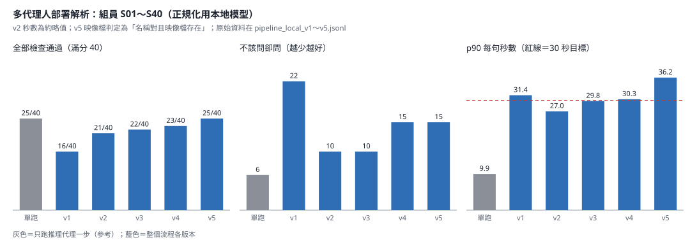

# 多代理人部署解析：組員 S01～S40 測試紀錄（2026-11-16～11-17）

## 測什麼
- 題目：組員出的 40 句（`experiments/model_select/reason/testset_s.jsonl`，簡單 10、中等 18、困難 12），評分標準由組員的文字標準轉成程式（`run_reason.py` 的 `CHECKS`）。
- 跑的是整個流程 `agents/pipeline/runner.run`（`run_pipeline_eval.py`）：正規化 → 意圖檢查② → 空缺檢查（推理代理）→ 選軟體 → 額外欄位對應。
- **正規化用本地模型**：這段時間 Gemini 兩把 key 都回 402（Capstonek8s 專案沒有預付餘額），Gemini 那條路徑沒測到。
- 模型：Qwen3.5-4B 4-bit（nf4），RTX 5080 筆電。筆電會被功耗限制降頻，秒數只能當參考。
- 原始結果：`docs/bench_record/pipeline_s40/pipeline_local_v1～v8.jsonl`（每題有輸入、預測、每一項檢查的對錯、耗時、整個中間 JSON）。

## 結果

| 版本 | 改了什麼 | 全部通過 | 映像檔 | 該問的有問 | 不該問卻問 | p50／p90 秒 |
|---|---|---|---|---|---|---|
| 推理代理單跑（參考） | 只跑推理代理一步 | 25/40 | 26/36 | 4/4 | 6 | 6.4／9.9 |
| v1 | 第一版流程 | 16/40 | 27/36 | 3/4 | 22 | 23.3／31.4 |
| v2 | 收緊意圖檢查、「不對外」「定時」要有明確字眼 | 21/40 | — | 2/4 | 10 | 約 21／27 |
| v3 | 排除「連不上」這種雙重否定、排程格式檢查 | 22/40 | 27/36 | 2/4 | 10 | 21.1／29.8 |
| v4 | 推理代理只收原句；RAG 查證捏造的映像檔 | 23/40 | 25/36 | 4/4 | 15 | 22.4／30.3 |
| **v5** | 加「選軟體」步驟（從 RAG 候選挑）；知識表加 LinuxServer.io | **25/40** | **27/36** | **4/4** | 15 | 26.1／36.2 |

v5 的分數用的映像檔判定是「軟體名稱對、而且映像檔確實存在（在知識表裡）」。
原本的評分程式比的是完整名稱，`linuxserver/bookstack` 對不到標準答案的 `bookstackapp/bookstack`，`linuxserver/piwigo` 對不到 `piwigo/piwigo`，所以照原本評分程式 v5 是 23/40。
同一條規則套到 v3、v4 分數不變；v3 捏造的 `mikecrain/wiki`、`redis/redis` 名稱剛好對得上，但映像檔不存在，所以不算。

## 「不該問卻問」15 題的分類（v4／v5）

| 類型 | 題目 | 說明 |
|---|---|---|
| 定時執行不支援 | S13、S22、S28、S31 | 這 4 題真的要定時跑。平台還沒有 CronJob，依設計問使用者「改成一直執行／先不部署」 |
| 保存空間超過 5GB | S24、S33 | 依設計不自動調低，問使用者 |
| 捏造的映像檔改成問題 | S05、S14、S36 | 原本就是錯的，改成問題卡並附候選；「幫我決定」時 S05 推薦 mediawiki（對），S36 推薦 xwiki、S14 推薦 lightstreamer（不在標準答案） |
| 誤判成定時執行 | S19、S30 | 真的錯：S19「定時去抓數據」是監控軟體本身的行為；S30 的「每 5 分鐘」講的是另一個程式 |
| 模型自己想問 | S07、S27、S29、S33、S35 | 都附推薦值和「幫我決定」 |

前兩類（6 題）是平台限制造成的，評分標準假設平台支援 CronJob、沒有 5GB 上限。

## 選軟體步驟實際做了什麼（v5）
- 推理代理推出軟體的 19 題都跑了這一步，每題多 2～3.5 秒。
- 維持原本選擇 15 題，原本對的（nginx、gitea、wordpress、prometheus、nextcloud）都沒有被換掉。
- 換掉 4 題：S27 SOP 知識庫 nextcloud → bookstack（對）、S24 照片 nextcloud → piwigo（對）、S10 論壇 wordpress → friendica（接近論壇，但不在標準答案）、S20 書籍目錄 nextcloud → lazylibrarian（換錯）。

## 意圖符合檢查代理（v6～v8，11-17 下午）
手稿「agent_意圖檢查」第一點：檢查系統填的值有沒有和使用者講的矛盾。發現矛盾 → 修正 → 最多 3 輪 → 修不好問使用者。程式在 `agents/pipeline/verify.py`。

| 版本 | 檢查範圍 | 全部通過 | 原評分程式 | 不該問卻問 | 一般／較慢耗時（秒） |
|---|---|---|---|---|---|
| v5（沒有檢查代理） | — | 25/40 | 23/40 | 15 | 26.1／36.2 |
| v6 | 全部項目 | 25/40 | 23/40 | 20 | 30.3／38.1 |
| v7 | 全部項目＋防來回改 | 25/40 | 23/40 | 19 | 31.7／38.9 |
| **v8（採用）** | **只檢查「要不要定時執行」** | **25/40** | **23/40** | **15** | **26.0／37.0** |

- **v6**：
  - 改對 1 題：S19 不再被當成定時執行。
  - 改錯 1 題：S02 要給朋友看的部落格被改成不對外。
  - 而且會來回改：S03 保存資料要→不要→要；S09 服務類型；S24 副本數 1→2→1。來回改完還做成問題卡，多問從 15 增加到 20。
- **v7**：加了「同一欄位被要求改回去，就判定不確定，恢復原值、不問」。來回改的 6 題都恢復了，但整體分數沒變，仍多問 19 題；S19 的改正也因為來回改被恢復掉。
- **v8**（使用者 11-17 決定）：只檢查「要不要定時執行」，沒有排程的句子不呼叫模型。
  - 有排程的 5 題（S13、S19、S22、S28、S31）都檢查了，模型都判斷「沒有矛盾」，所以沒有改任何東西，也沒有多問。
  - **v6 改對的 S19，這次沒有重現**：給模型的資料只剩排程和服務類型，它就沒判出來。
  - 結果和 v5 幾乎一樣：分數、多問相同，速度差不多（一般 26.0 秒；較慢的 37.0 秒，v5 是 36.2 秒）。

**結論**：意圖符合檢查目前**沒有讓分數變好**。縮小範圍後不會讓結果變差，大部分句子也不會變慢。它在 40 題裡只有 1 次改對，而且沒有重現，證據不足以說它有效。程式保留，其他項目要打開只要改 `verify.CHECK_FIELDS`。

## 還沒解決
- **論壇類**（S10、S34）：flarum、nodebb、discourse 不在任何一份中立的公開清單裡（Docker 官方映像檔、LinuxServer.io），沒有為了這次測試把標準答案加進知識表。
- **速度**：p90 36.2 秒，超過 30 秒目標。正規化一步約 8～10 秒，Gemini 有額度後這一步會換成 Gemini，但還沒實測。
- **調整都是看著這 40 題做的**，分數偏樂觀。要用沒看過的題目（r1～r3、最後的 r4）才算數。
