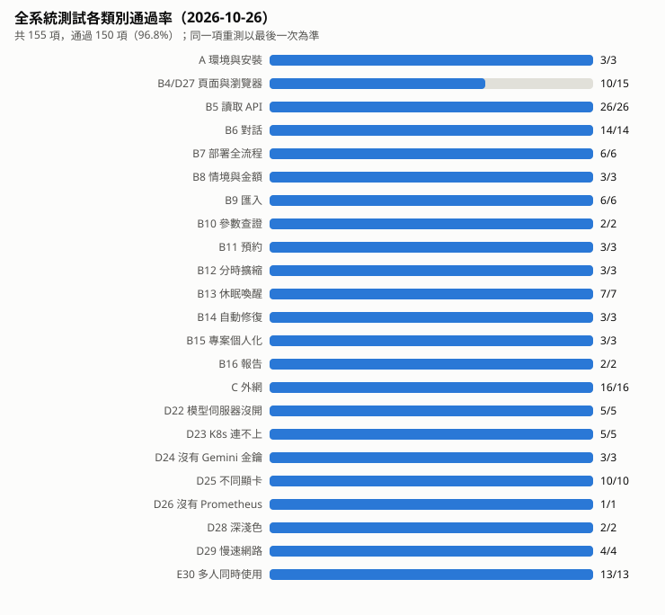

# 專題展前全系統測試（2026-10-26）

逐項資料：`docs/qa_full_20261026_results.jsonl`（同一個 id 以最後一筆為準）；摘要：`docs/qa_full_20261026_summary.json`；
圖表：`docs/qa_full_20261026_by_group.svg`；三人同時使用的逐步明細：`docs/qa_concurrent_local_20261026.jsonl`。
測試程式：`qa_full_20261026.py`（主體）、`qa_concurrent_local_20261026.py`（E30）、`qa_full_20261026_summarize.py`（重新產生摘要與圖表）。
測試帳號密碼從環境變數讀（`QA_DEMO_USER`、`QA_DEMO_PW`、`QA_USER_PW`），不寫在程式裡。

## 結果：155 項，150 項通過（96.8%）

| 類別 | 通過 | 說明 |
|---|---|---|
| A 環境與安裝 | 3/3 | 本機 pytest 869 項全過；Docker `python:3.9-slim` 模擬 CI 414 過、89 略過、0 失敗；全新虛擬環境照 requirements.txt 安裝 265 秒，未裝 torch 也能載入網站，686 項通過 |
| B4/D27 頁面與瀏覽器 | 10/15 | Chrome、Firefox 各 4 種螢幕寬度＋手機監控版全過；Safari 核心 5 項未過（見「未解決」） |
| B5 讀取 API | 26/26 | |
| B6 對話 | 14/14 | 含「現在健康嗎、狀況如何、目前還好嗎」與「什麼是健康檢查」不被誤判 |
| B7 部署全流程 | 6/6 | 部署、重送不重複、換版本、回滾、刪除 |
| B8 情境與金額 | 3/3 | 金額都附算式，照算式重算與畫面一致 |
| B9 匯入 | 6/6 | compose、K8s YAML、密碼改存機密物件 |
| B10 參數查證 | 2/2 | 「redis 7.2」保留版本；沒講映像檔時請使用者補，不自己猜 |
| B11 預約 | 3/3 | 到期提醒，使用者確認後才執行 |
| B12 分時擴縮 | 3/3 | 時段開始與結束後 10～13 秒內調整 |
| B13 休眠喚醒 | 7/7 | 有人連線後 6.3 秒恢復，喚醒器自動收掉 |
| B14 自動修復 | 3/3 | 映像檔錯誤 10 秒退回；記憶體不足 32→64→128Mi，約 7 分鐘恢復並穩定 |
| B15 專案、回收桶、個人化 | 3/3 | |
| B16 分析報告 | 2/2 | |
| C 外網 | 16/16 | 從網際網路另一端連線、HTTPS 登入、外網安全設定 |
| D22～D26 設定不完整的電腦 | 24/24 | 模型伺服器沒開、K8s 連不上、沒有 Gemini 金鑰、10 種顯卡配置、沒有 Prometheus |
| D28 深淺色、D29 3G 慢速網路 | 6/6 | 3G 下登入頁 8.7 秒、首頁 356 KB |
| E30 三人同時使用 | 13/13 | 問答、部署、擴縮、隔離、刪除全過；問答平均延遲單人 13.0 秒、三人同時 10.3 秒（最慢 13.2 秒），整段 50 秒 |

有延遲紀錄的 99 項：中位數 0.18 秒、第 90 百分位 6.3 秒；最長的是記憶體不足自動修復（約 7 分鐘，受 3 分鐘冷卻時間限制）。

## 這次測試找到並修好的問題

1. **K8s 沒連上時顯示「部署完成」**：後端回傳空結果，前端、重送快取、事件紀錄都當成成功；連上叢集後按「再試一次」還會拿到舊結果，服務永遠不會啟動。改成明確回報失敗並附處理步驟（`tests/test_deploy_idempotency.py`）。
2. **自動修復會處理休眠用的喚醒器**：改成跳過帶 `zerotouch/waker` 標籤的 Pod（`tests/test_healer_scope.py`）。
3. **問健康狀況被當成一般問答**：「qa-web 現在健康嗎」不會去查 Pod 狀態。前後端規則允許「現在、目前、狀況如何、還好嗎」等說法（`tests/test_web_demo_routes.py`）。
4. **沒講映像檔被自動補成 nginx**：「幫我部署一個快取服務」原本會部署網頁伺服器。改成回「還缺少：映像檔」，部署單請使用者補（`tests/test_deploy_grounding.py`）。
5. **回覆提到真實的 Pod 名稱被當成幻覺**：三人同時使用時，有一人問服務狀態，回覆整段被換成「更正：qa-c2-web-657b99cf6b-trfd8 不存在」。事實查核只比對服務名稱、沒比對 Pod 名稱；改成兩者都比對，捏造的 Pod 名稱仍會被擋（`tests/test_chat_grounding.py`）。

## 判定規則寫錯、已更正的項目

B6-6（意圖名稱是 update_image）、B6-chat（回覆用中文「一個」）、B9-3（密碼在部署時才轉成機密物件）、B14-2（8Mi 的 redis 根本不會記憶體不足，改用真的會超用記憶體的程式）、C20-3（同一分鐘內先登入過一次，被登入次數限制擋下）、D24（PowerShell 把空字串環境變數當成刪除，第一次其實有 Gemini，改用空白字元重測）、B13（第一次同時開了多個網站程序，見下方）。

## 展場要注意

- **同一個叢集只能跑一個平台網站。** 同時開兩個以上，彼此的背景檢查會把對方剛建立的喚醒器收掉，休眠的服務就叫不醒。正式環境只開一個時，休眠喚醒全部通過。
- 正式網站（5050）是客戶自帶叢集模式，展示帳號要先接上叢集才能部署。

## 未解決、需要使用者配合

- **Safari 核心**：Windows 版 WebKit 切到自動修復頁時整個當掉；同一次執行還出現頁面元素讀不到的錯誤（`cpuEl`、回收桶），推測是那次登入狀態沒有保住（WebKit 在 http 下不送 Secure cookie）。Chrome、Firefox 同樣頁面沒有錯誤。需要用 iPhone 實測確認。
- **21 手機行動網路連公開網址**、**31 重開機後自動啟動**：需要使用者本人操作。

## 觀察（沒有判定為錯誤）

- NVIDIA 6GB 顯卡沒裝 bitsandbytes 會改用 CPU，說明只寫在啟動紀錄，畫面上看不到。
- 記憶體不足連續調整時每次間隔 3 分鐘冷卻，兩次調整約 7 分鐘才恢復。
