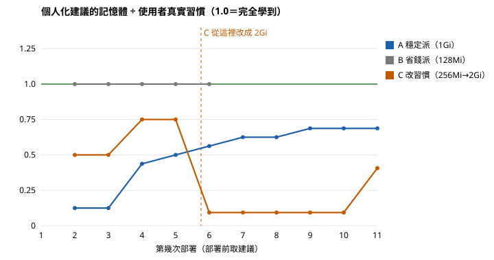

# 個人化建議與分時擴縮實測（2026-10-25）

測試對象是組員 10/23 完成的個人化部署建議（`agents/personalize.py`）與分時擴縮。另開本機模式的測試網站，註冊三個模擬使用者，照固定習慣走真實的 `/api/deploy` 部署，每次部署前取一次建議，與真實習慣比較。測完已刪除帳號、命名空間與事件紀錄。

- 原始資料：`docs/sim_personalize_20261025.jsonl`（每列一次部署，含 `passed` 與判定規則）
- 圖表：`docs/sim_personalize_20261025.svg`

## 判定規則
記憶體與 CPU 的建議值都落在真實習慣的 0.8～1.25 倍之間，才算「學到習慣」。副本數另外看。

## 結果

| 模擬使用者 | 習慣 | 有建議的次數 | 算學到的次數 |
|---|---|---|---|
| A 穩定派 | 3 個副本、1Gi、500m | 10 | 0 |
| B 省錢派 | 1 個副本、128Mi、100m | 5 | 5 |
| C 改習慣 | 前 5 次 2 個／256Mi，後 6 次 4 個／2Gi | 10 | 0 |

## 發現的問題
1. **前 3 次的建議對每個人都一樣**：三種公開風格的副本數、記憶體、CPU 中位數都是 1 個、約 128Mi、100m。B 全部算學到，只是因為他的習慣剛好等於這組預設值。
2. **學得慢，而且到不了**：公式是「風格值 ×（1−w）＋ 個人中位數 × w」，w＝n／(n＋5)。A 部署 10 次後，記憶體建議仍只有 704Mi（習慣的 69%），CPU 350m（70%）；n 最多算到 50，理論上限約 91%。
3. **換習慣跟不上**：用的是全部紀錄的中位數，不看時間。C 改用 2Gi 之後，連續 5 次建議仍是 192Mi（9%），第 6 次才跳到 832Mi。
4. **句子有「一個」就不建議副本數**：「部署一個 nginx」的「一個」被當成使用者指定了副本數。中文的「一個」多半只是量詞，所以實際使用時副本數建議幾乎不會出現。
5. **副本數建議和說明互相矛盾**：A 每次都開 3 個，畫面寫「大多開 3 個副本」，建議值卻是 2（同樣被公開風格的 1 拉低）。
6. **風格分類永遠是「正式環境型」**：平台每次部署都會加健康檢查，分類特徵「有健康檢查」固定是 1，三個人（包括只用 latest、最低配置的 B）都被歸為「正式環境型」。

## 分時擴縮
設定 22:11～22:14 開 3 個副本、其他時間 1 個，每 20 秒用 kubectl 查叢集：22:11:28 變成 3、22:14:29 變回 1，兩次都在 30 秒內（背景每 30 秒檢查一次），行事曆記下兩筆擴縮事件。**功能正常。**

## 閒置休眠
這台（Docker Desktop 內建 Kubernetes v1.36）的 Prometheus 沒有容器網路流量指標，休眠不會動作，畫面已改成說明原因（`docs/security_review.md` 56 節）。組員 10/24 在學校 NVIDIA 筆電實測：測試服務 10 分鐘後自動休眠、有連線進來 5 秒內恢復（`docs/verification_20261024.md`）。本次沒有重測。
